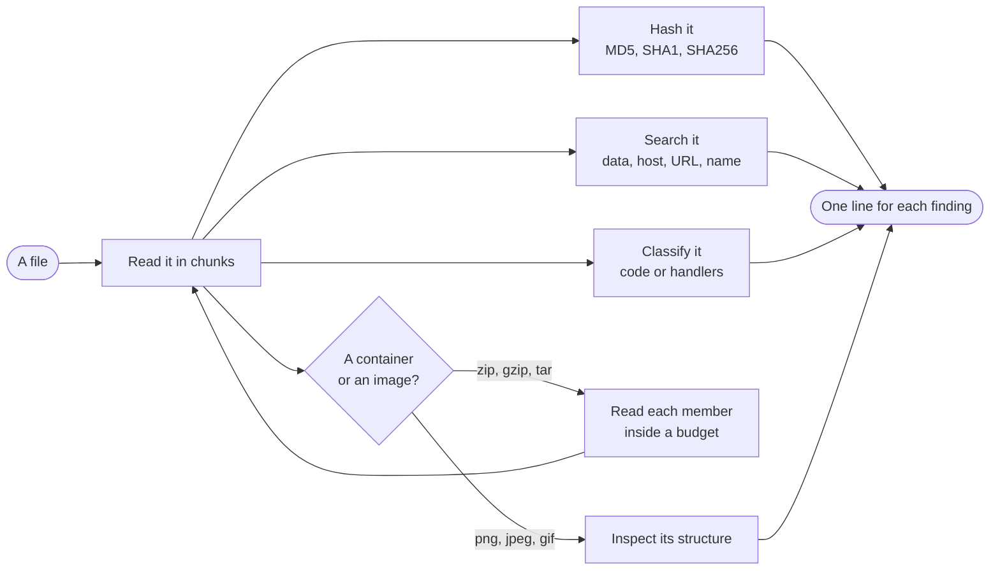

<p align="center">
  
</p>

<p align="center">
  <strong>A virus scanner for the command line, in one PHP file.</strong><br>
  Portable, self updating & built to be run by other programs.
</p>

<p align="center">
The scanner that tells you what a file <i>is</i>, what it <i>can do</i> & what it <i>could not read</i>.
</p>

<p align="center">
  No cookies &nbsp;&middot;&nbsp; No databases &nbsp;&middot;&nbsp; No third party connections &nbsp;&middot;&nbsp; No analytics &nbsp;&middot;&nbsp; No exceptions
</p>

<p align="center">
  <a href="#-quick-start"><strong>Get Started</strong></a> &middot;
  <a href="#-every-switch">Every Switch</a> &middot;
  <a href="Documentation">Documentation</a> &middot;
  <a href="Documentation/SECURITY.md">Security Policy</a>
</p>

---

ScanCore scans files & folders for viruses. Point it at a path. It reads every file, opens every archive it finds inside & prints one line for each thing worth knowing.

The whole scanner is one PHP file, a configuration file & two plain text definition files. There is nothing to compile, nothing to install & no service to keep running. A machine that has PHP 8 has everything ScanCore needs, & that includes a Raspberry Pi.

It was built to be run by other programs as much as by people. [HRConvert2](https://github.com/zelon88/HRConvert2) runs it on every upload & [HRProtect](https://github.com/zelon88/HRProtect) runs it on every scan. So what it prints is a contract: four words, each in a fixed place, that a calling program can rely on from one release to the next.

> [!IMPORTANT]
> **ScanCore scans what you point it at, when you run it.** It does not watch a machine in the background, & it never deletes, moves or changes a file that it scans. It reports. What happens next is yours to decide.

---

## 👀 See It Work

A folder of uploads. One is the harmless test file that every scanner knows, one is an archive with that file two zips deep, & two are pictures that are more than pictures.

```
$ php ScanCore.php /srv/uploads -r
Starting ScanCore!
Infected: /srv/uploads/backups.zip (Trojan.Eicar.4, SHA256 Hash Match: 275a021bbfb6489e54d471899f7db9d1663fc695ec2fe2a2c4538aabf651fd0f in 2026/invoice.zip > invoice.pdf.exe)
Classified: /srv/uploads/bracket.scad (File may contain file or URL handlers - Type: scad, Handlers: include(file), import(file|url), surface(file))
Infected: /srv/uploads/eicar.com (Trojan.Eicar.4, SHA256 Hash Match: 275a021bbfb6489e54d471899f7db9d1663fc695ec2fe2a2c4538aabf651fd0f)
Infected: /srv/uploads/holiday.png (Embedded.PHP, Structure Match: <?php )
Suspicious: /srv/uploads/holiday.png (Embedded.Execution, Structure Match: system($_)
Suspicious: /srv/uploads/logo.png (Polyglot.PNG.TrailingData, Structure Match: 320 bytes follow the end of the image)
Incomplete: /srv/uploads/payroll.zip (an encrypted member cannot be inspected)
Scanned 7 files in 1 folder.
Found 1 file that may contain file or URL handlers.
Found 0 files that may contain executable code.
Found 1 file that could not be fully inspected.
Found 1 suspicious file.
Found 3 infected files.
```

Five things in that output are the whole idea.

- **The archive was opened, & so was the archive inside it.** The line for `backups.zip` ends with where the match was made, which is `in 2026/invoice.zip > invoice.pdf.exe`. A container is read in place & inside a budget. Nothing is ever extracted to disk.
- **`holiday.png` is a real picture.** It opens in any viewer. It also carries PHP in a text chunk, & no definition names it. ScanCore found it by inspecting the structure of the file.
- **`bracket.scad` is not a threat, & is not called one.** `Classified` says what a file is able to reach for when something opens it. That is a different question from whether the file is known to be bad.
- **`payroll.zip` is not called clean.** It holds an encrypted member that ScanCore could not read, so it says so. A scanner that calls what it could not read clean is guessing.
- **It exited 0.** Finding something is a scan that worked. What was found is read from the lines, & never from the exit status.

---

## 🔍 What It Looks For

| It finds | By | Reported as |
| :--- | :--- | :--- |
| 🧬 **A known sample** | The MD5, SHA1 or SHA256 hash of the whole file. | `Infected` |
| 🧵 **A known string** | A content signature, which may hold raw bytes. | `Suspicious` |
| 🌐 **A known address** | A host name or a URL inside the file. | `Suspicious` |
| 🏷️ **A known name** | The name of the file. | `Suspicious` |
| 💣 **A decompression bomb** | Measuring an archive or a png as it is read, whatever its headers claim. | `Infected` |
| 🖼️ **Code hidden in a picture** | Searching every png, jpeg & gif for embedded code. | `Infected` or `Suspicious` |
| 🎭 **A file that is not what it claims** | Checking a png chunk by chunk, & looking for an archive behind an image. | `Suspicious` |
| 🔗 **What a data file can reach for** | Finding the file & URL handlers that it carries. | `Classified` |
| 📜 **Source code under any name** | The extension of the file, or the signatures of a language. | `Classified` |
| 🚧 **Anything it could not read** | Saying so. | `Incomplete` |

A hash is an exact match, so it is `Infected` by default. A string, an address & a name are heuristics, so each is `Suspicious` by default. A definition may say otherwise with `confidence=`.

**A match inside an archive names the member it was made in.** Every member of a zip, a gzip stream & a tar is matched, classified & inspected as a file is, & so is every container nested inside it.

---

## 🧾 Four Words

Every finding is one line, & every line opens with one of four words. A person reads the line. A program reads the word.

| The line opens with | What it means | What a caller concludes |
| :--- | :--- | :--- |
| `Infected:` | A detection of high confidence. | Stop. Do not open the file. |
| `Suspicious:` | A detection of medium or low confidence. A heuristic, & not proof. | Decide by policy. `-nosuspicious` leaves these out. |
| `Classified:` | What the file is able to do. Never a threat by itself. | Nothing, unless what a file can reach for matters to you. |
| `Incomplete:` | Part of the file could not be inspected, & the line says why. | The file is not known to be clean. |

A scan closes with a count of each.

```
Scanned 7 files in 1 folder.
Found 1 file that may contain file or URL handlers.
Found 0 files that may contain executable code.
Found 1 file that could not be fully inspected.
Found 1 suspicious file.
Found 3 infected files.
```

> [!TIP]
> **Writing a program that runs ScanCore?** [`ABOUT_REPORTS.txt`](Documentation/ABOUT_REPORTS.txt) is the contract. It gives the four steps that read a verdict, says exactly what will never change, & names the function in the behaviour test that you can check your own reader against.

---

## ⚡ Quick Start

```bash
git clone https://github.com/zelon88/ScanCore.git
cd ScanCore
php ScanCore.php -version               # Says what this installation is & which files it uses.
php ScanCore.php /path/to/scan -r       # Scans a folder & every folder inside it.
php ScanCore.php -updatedefinitions     # Fetches the newest virus definitions.
php ScanCore.php -help                  # Lists every switch.
```

On Windows it is the same thing with longer paths.

```
C:\PHP\php.exe C:\ScanCore\ScanCore.php C:\Windows\Temp -r -v
```

1. Type the path to a PHP 8 binary, or `php` where it is in your PATH.
2. Type the path to `ScanCore.php`.
3. Type the file or folder to scan. It is always the first argument.
4. Type any switches after it, separated by spaces.

### 📋 Requirements

| | Needs |
| :--- | :--- |
| **PHP** | 8.0 or later, run from a command line. ScanCore refuses any other interpreter. |
| **OS** | Linux or Windows. |
| **Hardware** | A Raspberry Pi Model B+. Any x86 or x64 machine is comfortable. |
| **zlib** | Optional. Reads compressed archive members & png chunks. Without it they are reported as `Incomplete`. |
| **posix** | Optional. Hands new files to the right owner when ScanCore is run as root. |
| **git** | Optional. The default update method clones with it, & falls back to downloading each file where git is missing. |
| **curl** | Optional. Downloads an update where PHP may not open a URL itself. |

**A scan runs no other program.** An update may run `git`, `curl` & the `php` binary, & that is the whole list.

---

## 🔧 Every Switch

The path to scan comes first & every switch comes after it. Every switch has a long form & a short form. Most of them override an entry of `ScanCore_Config.php` for that one run, & leave the file as it is.

A switch that is given a bad value falls back before it fails. The configured value or the built in default is used, & a warning is written to the report.

### 📂 What is scanned

| Switch | Short | What it does |
| :--- | :--- | :--- |
| `-recursion` | `-r` | Scans the folders inside a folder as well. |
| `-norecursion` | `-nr` | Scans the files of a folder & opens none of the folders inside it. This is the default. |
| `-maxdepth NUMBER` | `-md` | How many folders deep a recursive scan goes. Default 64. |
| `-followsymlinks` | `-fs` | Follows a symbolic link that is found inside a scanned folder. |
| `-nofollowsymlinks` | `-nfs` | Skips every link. This is the default. |

### ℹ️ Information

| Switch | Short | What it does |
| :--- | :--- | :--- |
| `-version` | `-ver` | Prints the version, where the installation is, which files it uses & where it updates from. |
| `-help` | `-h` | Prints every switch. |

### 📝 The report

| Switch | Short | What it does |
| :--- | :--- | :--- |
| `-reportfile PATH` | `-rf` | Writes the report of this run to this file. A caller gives each run a report of its own. |
| `-logfile PATH` | `-lf` | The same switch under its older name. |
| `-maxlogsize BYTES` | `-ml` | A report that would grow past this is renamed & a new one is started. Default 33554432, which is 32 MB. |
| `-debug` | `-d` | Writes every entry to the report. |
| `-verbose` | `-v` | Prints every entry to the console. |
| `-suspicious` | `-sus` | Reports detections of medium & low confidence as `Suspicious`. This is the default. |
| `-nosuspicious` | `-nsus` | Reports detections of high confidence alone. |

### 🧠 Memory

| Switch | Short | What it does |
| :--- | :--- | :--- |
| `-memorylimit BYTES` | `-m` | The memory that a scan may use. Default 536870912, which is 512 MB. |
| `-chunksize BYTES` | `-c` | How much of a file is read & searched at a time. Default 8388608, which is 8 MB. |

### 🧪 Definitions & configuration

| Switch | Short | What it does |
| :--- | :--- | :--- |
| `-configfile PATH` | `-cf` | Loads this configuration file in place of `ScanCore_Config.php`. |
| `-defsfile PATH` | `-df` | Scans against this definitions file. |
| `-mindatasignature NUMBER` | `-mds` | A content signature with fewer bytes than this is not searched for. Default 4. |
| `-nohashindex` | `-nhi` | Reads the definitions file & neither loads nor builds an index. |
| `-rebuildindex` | `-ri` | Builds the index again. |
| `-hashindexthreshold NUMBER` | `-hit` | The number of hashes a definitions file must hold before an index is built for it. Default 10000. |

### 🏷️ Classification

| Switch | Short | What it does |
| :--- | :--- | :--- |
| `-classify` | `-cy` | Classifies every scanned file. This is the default. |
| `-noclassify` | `-ncy` | Classifies nothing. |
| `-classifiers LIST` | `-cl` | Switches on the classifiers in a comma separated list, such as `scad,pdf,language`, & no others. |
| `-minlanguagesignatures NUMBER` | `-mls` | The signatures of one language that a file with an unclaimed extension must carry to be reported as code. Default 2. |

### 📦 Containers

| Switch | Short | What it does |
| :--- | :--- | :--- |
| `-inspectarchives` | `-ia` | Opens zip, gzip & tar containers. This is the default. |
| `-noinspectarchives` | `-nia` | Opens no container. |
| `-maxarchivedepth NUMBER` | `-mad` | A container nested deeper than this is reported as `Infected` & is not opened. Default 5. |
| `-maxarchiveentries NUMBER` | `-mae` | The members that are inspected inside one scanned file. Default 4096. |
| `-maxarchiveentrysize BYTES` | `-maes` | The bytes that are read from any one member. Default 8388608, which is 8 MB. |
| `-maxarchivetotalsize BYTES` | `-mats` | The bytes that are read from the members of one scanned file in total. Default 67108864, which is 64 MB. |
| `-maxarchiveratio NUMBER` | `-mar` | The number of times that a member may expand beyond its stored size. Default 200. |

### 🖼️ Images

| Switch | Short | What it does |
| :--- | :--- | :--- |
| `-inspectimages` | `-ii` | Checks the structure of a png & searches every png, jpeg & gif for embedded code. This is the default. |
| `-noinspectimages` | `-nii` | Inspects no image. |
| `-maximagepixels NUMBER` | `-mip` | The largest image, as its width multiplied by its height, that is not reported as `Infected`. Default 268435456, which is 16384 by 16384. |
| `-maximagechunksize BYTES` | `-mics` | The bytes that a compressed chunk of a png may expand to. Default 8388608, which is 8 MB. |

### 👑 Ownership

These three do something only when ScanCore is run as root.

| Switch | Short | What it does |
| :--- | :--- | :--- |
| `-owner NAME` | `-ow` | The user that owns anything ScanCore creates. |
| `-group NAME` | `-gr` | The group that owns anything ScanCore creates. |
| `-nopreserveownership` | `-npo` | Leaves whatever root creates owned by root. |

### 🔄 Updates

| Switch | Short | What it does |
| :--- | :--- | :--- |
| `-updatedefinitions` | `-ud` | Downloads the subscribed definitions, verifies them & swaps them in. |
| `-updateapplication` | `-ua` | Downloads every subscribed application file, verifies the whole set & swaps it in. |
| `-updatemethod METHOD` | `-um` | `git` or `raw`. Default `git`. |
| `-connectiontimeout SECONDS` | `-ct` | How long to wait for an update host. Default 15. |

[`ABOUT_COMMAND_LINE_ARGUMENTS.txt`](Documentation/ABOUT_COMMAND_LINE_ARGUMENTS.txt) says more about each one, with the entry it overrides & the smallest value it accepts.

---

## ⚙️ How A File Is Scanned



- **A file is read once, in chunks.** Each chunk feeds three hashes & is searched as it passes, so a file of any size is scanned in the memory that two chunks take.
- **A signature across two chunks is still found.** The end of each chunk is carried into the next, & a name is never read in halves.
- **A header never decides how much is read.** Every read stops at a budget. A budget that is reached is reported, & the budgets are fitted to the memory limit before a scan begins.
- **One file cannot end a scan.** A file that cannot be opened, cannot be read or trips a fault inside ScanCore is reported as `Incomplete`, & the scan goes on to the next file.

[`ABOUT_SCANNING.txt`](Documentation/ABOUT_SCANNING.txt) follows a file through every step.

---

## 📦 Containers & 🖼️ Images

**A zip, a gzip stream & a tar are opened**, & every member is matched against the virus definitions. A container inside a container is opened in turn, & a zip that is appended to a file of another format is found & opened as well.

```
Infected: /path/to/file (Name, SHA256 Hash Match: 7d14bfe... in outer.zip > inner.zip > payload.bin)
```

Five limits govern how far a container may expand: the entry count, the entry size, the total size, the compression ratio & the nesting depth. A container that breaks the ratio, the declared total or the depth is reported as `Infected`, & so is a zip whose entries share the same stored bytes. Their names begin with `Bomb`.

**A png is checked chunk by chunk.** An image with more pixels than `MaxImagePixels`, a chunk that expands past `MaxImageChunkSize` & image data that inflates past what its header declares are reported as `Infected`. A damaged chunk, bytes after the end of the image, a hidden archive & a file that is named as a png & is not one are reported as `Suspicious`.

**Every png, jpeg & gif is searched for embedded code.** The signatures are the `embed` records of `ScanCore_Classifiers.def`.

> [!NOTE]
> **What it does not open, it says.** An encrypted member, a bzip2 stream, a damaged archive & a container that ran out of budget each draw an `Incomplete` line. 7z, rar, xz & zstd containers are not recognised, & are scanned as the one file that each of them is. The frames of an animated png are checksummed & are not inflated.

---

## 🏷️ Content Classification

The virus scanner asks whether a file is known to be bad. The classifier asks what a file is able to do if something opens it. Those are different questions, & they are reported separately.

A handler is a construct that lets a data file reach out to another file or another host. An OpenSCAD source can name another file with `include` or `surface`. A playlist names other hosts by design. A word processing document can carry a relationship that points at an outside address. The classifier reports what is present so that a caller can decide whether to go on. It neutralises nothing.

```
Classified: /path/to/model.scad (File may contain file or URL handlers - Type: scad, Handlers: include(file), surface(file))
Classified: /path/to/script.php (File may contain executable code - Detected Language: PHP)
```

Executable code is detected first. A file that is recognised as source code is reported as code & is not classified for handlers, because at that point the whole file is a handler.

Classifiers are declared in [`ScanCore_Classifiers.def`](ScanCore_Classifiers.def), which is plain text that you can read & extend. It covers documents, spreadsheets, presentations, PDF, XPS, SVG, markup, OpenSCAD, 3D models, drawings, e-books, subtitles, playlists & transport streams. `-classifiers` chooses which ones run.

---

## 🧬 Virus Definitions

A definition is one indicator on one line, & nothing about it is positional.

```
sha256 Trojan.Win32.DarkComet   = 7d14bfe...           src=malwarebazaar confidence=high
name   Trojan.Win32.FormBook    = "Receipt.exe"        confidence=low
host   Malware.C2.Emotet        = "evil.example"       confidence=medium
url    Malware.Dropper.Foo      = "http://x/y.php"     confidence=medium
data   Exploit.CVE-2016-7200    = "\x4d\x5a\x90"       scope=pdf
```

- **The kind is named on every line**, so a hash can never end up in the wrong column.
- **A host sits on a name boundary**, so an indicator of `ow.ly` cannot match inside `snow.lyrics`.
- **A byte with no printable form is written as an escape**, so a definitions file stays a text file that you can read in a diff.
- **`confidence=` decides which word opens the line.** A hash defaults to high & everything else to medium.
- **`scope=` holds a definition to one type of file.**
- **A large set gets a packed index.** A definitions file with a million hashes is ready in under a second, from an index that is written beside it. The index is rebuilt whenever the definitions change.

Definitions are published at [zelon88/ScanCore_Definitions](https://github.com/zelon88/ScanCore_Definitions), in categories. `--Definition Subscriptions--` in `ScanCore_Config.php` chooses the categories that an installation takes, so a server can carry the definitions that suit its role & no others.

---

## 🔄 Updates

```bash
php ScanCore.php -updatedefinitions     # The virus definitions.
php ScanCore.php -updateapplication     # ScanCore itself.
```

**An update is staged, verified, swapped & tested.** Nothing that is installed is touched until every downloaded file has passed its checks. A new core that does not answer `-version` is undone, file by file, & the installation is left as it was.

- **Your configuration is replaced & kept.** `-updateapplication` installs the published `ScanCore_Config.php` & keeps a numbered backup of yours beside it. Copy your values across afterwards.
- **A release that adds files arrives in two updates.** The first brings the new list of files, & the second brings the files on it. Coming from v1.9, run `-updateapplication` twice.
- **It falls back before it fails.** `git` clones the repository. `raw` fetches each file by itself, with PHP where PHP may open a URL & with `curl` where it may not. An update by `git` that produces nothing falls back to `raw`.
- **An update is trusted on the certificate of its host.** Nothing that is downloaded carries a signature of its own.

It connects to nothing while it scans. An update connects to the repository that `ScanCore_Config.php` names, & only when you ask for one.

---

## 👑 Running As Root

An administrator who runs an update under `sudo` would otherwise leave every file owned by root, & the account that runs ScanCore the rest of the time could no longer write its own report or install its own update.

Anything that ScanCore creates while it runs as root is handed to the user & the group that own the installation directory. `-owner` & `-group` name another account, & so do `OwnerUser` & `OwnerGroup` in the configuration file.

A file that an update replaces keeps the owner & the mode that it had. A link, or a file with a second hard link, is left exactly as it is, because changing it by name would change whatever it leads to. None of this does anything unless the process is root.

---

## 🚦 Exit Status

| Status | Meaning |
| :--- | :--- |
| `0` | ScanCore did what it was asked. A scan that found something exits `0`, exactly as one that found nothing does. |
| `1` | ScanCore could not do what it was asked, & a numbered error says why. |

Any other status is the interpreter's own. A status other than `0` is never a verdict, & a caller that sees one treats every path it handed over as not scanned.

---

## 💡 Usage Tips

- **A small chunk is as accurate as a large one.** A signature across two chunks is still found, so lowering `-chunksize` lowers memory use & costs nothing in detection.
- **A folder is not entered unless you say so.** `-r` scans the folders inside a folder. Without it only the files of the folder itself are scanned.
- **Links are skipped unless you ask for them.** A looping link would otherwise make a recursive scan walk the same files again & again.
- **`-v` & `-d` on a whole disk make very large reports.** The report rotates at `-maxlogsize` & does not grow without limit.
- **ScanCore never scans its own definitions file, a copy of it, or its own report.** Each of them quotes signatures by design.
- **Give every automated run a report of its own.** `-reportfile` settles the report before anything is written, so nothing of one run lands in the report of another.
- **One scanner can serve many roles.** `-configfile` & `-defsfile` let one installation scan with a different configuration & different definitions for each job.

---

## ✅ Tested Like It Matters

Two tools ship with ScanCore, & both need nothing but PHP. Run them from the folder that holds `ScanCore.php`.

```bash
php Documentation/Build/scancore-check-cli.php     # Holds the code, the configuration & the documents to each other.
php Documentation/Build/scancore-test-cli.php      # Runs ScanCore the way a caller does & judges what it says.
```

- **The check reads.** It holds every switch, every default, every error, every warning & every documented line of output to the code that produces it, in both directions. A switch that is not documented fails it, & so does a document that describes a switch which is gone.
- **The test runs.** It builds every file that it scans, from an ordinary picture to a zip bomb, & holds what ScanCore prints, writes & exits with to answers that were written by hand. It writes no real malware anywhere.
- **Both are proven to fail.** The test fails against the release before this one, once for each defect that this release fixed.

[`ABOUT_QUALITY_CONTROL.txt`](Documentation/ABOUT_QUALITY_CONTROL.txt) says what each one proves & what neither can see.

---

## 🔐 Security

A scanner opens hostile files for a living. If you have found a way to make ScanCore miss, lie, fall over or be taken over, report it privately from the **Security** tab, & never in an issue. Every report is accepted, & every reporter is credited once the fix ships. See the [Security Policy](Documentation/SECURITY.md).

---

## 📚 Where To Read More

| Document | What it covers |
| :--- | :--- |
| [`ABOUT_COMMAND_LINE_ARGUMENTS.txt`](Documentation/ABOUT_COMMAND_LINE_ARGUMENTS.txt) | Every switch, the entry it overrides, its default & its minimum. |
| [`ABOUT_REPORTS.txt`](Documentation/ABOUT_REPORTS.txt) | Every line of output, how a calling program reads a verdict & what will never change. |
| [`ABOUT_SCANNING.txt`](Documentation/ABOUT_SCANNING.txt) | How a file is read, matched, classified & inspected, & what is not inspected. |
| [`ABOUT_QUALITY_CONTROL.txt`](Documentation/ABOUT_QUALITY_CONTROL.txt) | The two tools that check ScanCore, what each proves & how to prove that each can fail. |
| [`ERROR_DESCRIPTIONS.txt`](Documentation/ERROR_DESCRIPTIONS.txt) | Every numbered error & every warning, its cause & its remedy. |
| [`DEVELOPMENT_NOTES.txt`](Documentation/DEVELOPMENT_NOTES.txt) | Why each part is shaped the way it is, what it replaced & the gaps that are known. |
| [`CHANGELOG.txt`](Documentation/CHANGELOG.txt) | What changed & when. |
| [`SECURITY.md`](Documentation/SECURITY.md) | Which releases are supported, how to report a vulnerability & how a reporter is credited. |

Every document lives in [`Documentation`](Documentation).

---

## 📜 License

[GNU General Public License v3.0](LICENSE). BSD or MIT licensing is available. Reach out to [@zelon88](https://github.com/zelon88) for more information.

<p align="center">
  
  <br><sub>Built by <a href="https://github.com/zelon88">@zelon88</a> for people who would rather know what is in a file before they open it.</sub>
  <br><sub>&lt;3 Open-Source</sub>
</p>
